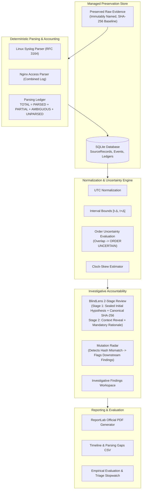
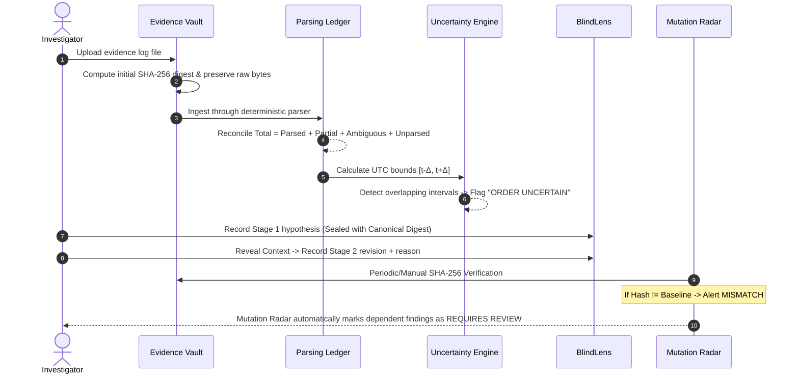

# TraceLens: Incident Timeline and Evidence Collection for Small Teams

> **AIORI-3 Hackathon** | **Problem Statement PS-013** | **Identifier: A3-PS013-TC208**  
> **Team:** Threat Tracers  
> **Tagline:** *"Trace evidence. Show uncertainty. Make review accountable."*

---

## 1. Executive Summary & Objective

Small security teams frequently lack expensive enterprise SIEM and forensic appliances. When responding to incidents across Linux servers and web reverse proxies, analysts face three critical failure points:
1. **Unaccountable Ingestion & Silent Parsing Failures:** Tools often discard malformed lines or quietly drop non-conforming entries, leaving gaps in evidence.
2. **False Precision & Clock Skew:** Syslog timestamps often omit timezones or years, and server clocks drift. Naively sorting timestamps gives a false illusion of chronological certainty.
3. **Evidence Drift & Investigator Bias:** Evidence files can change post-collection without detection, and investigators often adapt hypotheses based on unverified context without an audit trail.

**TraceLens** is a lightweight, explainable, and accountable application designed specifically for small security teams. It collects Linux (`auth.log`) and web (`nginx`) logs, preserves original evidence bytes, generates and verifies SHA-256 cryptographic baselines, parses logs with an explicit ledger accounting invariant, normalizes timestamps with uncertainty bounds, performs explainable clock-skew estimation, evaluates order uncertainty, tracks post-collection mutations with downstream impact mapping, enforces a staged investigator review workflow (BlindLens), and exports multi-page formal PDF reports.

---

## 2. Core Capabilities & Architecture

### System Architecture Diagram



### Data Flow Diagram



---

## 3. Technology Stack

- **Backend:** Python 3.12 / 3.13, FastAPI, Uvicorn, Pydantic v2, SQLAlchemy 2.x, SQLite (PRAGMA foreign_keys=ON)
- **Log Parsers:** Dedicated deterministic regex & state-machine parsers (`LinuxAuthParser`, `NginxAccessParser`)
- **Cryptography & Serialization:** Python standard `hashlib` (SHA-256), canonical JSON serialization (`sort_keys=True, separators=(',', ':')`)
- **Document Generation:** ReportLab 5.x for formal PDF report generation with custom `NumberedCanvas`
- **Frontend:** Vanilla ES Modules (`app.js`, `api.js`), HTML5, CSS3, Bootstrap 5.3 (no heavy framework, 100% offline-ready)
- **Testing & Quality Assurance:** pytest 9.x, pytest-asyncio, HTTPX, GitHub Actions CI

---

## 4. Installation & Local Startup

### Prerequisites
- Python 3.12+ (tested on Python 3.12, 3.13, 3.14 on Windows and Linux)
- Git

### 1. Clone the repository
```bash
git clone https://github.com/threat-tracers/tracelens.git
cd tracelens
```

### 2. Create and activate a virtual environment
```bash
# On Windows (PowerShell)
py -3.13 -m venv .venv
.\.venv\Scripts\Activate.ps1

# On Linux / macOS
python3 -m venv .venv
source .venv/bin/activate
```

### 3. Install pinned dependencies
```bash
pip install -r requirements.txt
```

### 4. Start the application
```bash
uvicorn app.main:app --host 127.0.0.1 --port 8000 --reload
```

### 5. Access the Interface
- **Web Application:** [http://127.0.0.1:8000](http://127.0.0.1:8000)
- **Interactive OpenAPI Documentation:** [http://127.0.0.1:8000/docs](http://127.0.0.1:8000/docs)
- **System Health Status:** [http://127.0.0.1:8000/api/health](http://127.0.0.1:8000/api/health)

---

## 5. Automated Testing

TraceLens includes a comprehensive automated test suite covering unit tests, integration tests, API client tests, and synthetic scenario verification.

```bash
# Run the full test suite with verbose output
pytest -v
```

### Test Coverage Highlights:
- **Evidence Integrity:** SHA-256 consistency, collision avoidance, path traversal neutralization (`../../../etc/passwd`).
- **Deterministic Parsers:** `auth.log` failed/accepted logins, PAM sessions, `nginx` combined format, quoted targets, malformed line handling.
- **Ledger Invariant:** Validates `TOTAL = PARSED + PARTIAL + AMBIGUOUS + UNPARSED` across all runs.
- **Timestamp Uncertainty:** Positive/negative timezone offsets, UTC normalization, overlapping intervals $\to$ `ORDER UNCERTAIN`.
- **Clock-Skew Analysis:** Known artificial offsets, multi-pair correlation, `INSUFFICIENT_MATCHES` safeguard.
- **BlindLens Review:** Canonical JSON digest stability, Stage 1/2 workflow, detection of unauthorized database payload alterations.
- **Mutation Radar:** Controlled evidence tampering detection, reactive review flag propagation to dependent findings.
- **ReportLab PDF & CSV:** Generation of multi-page incident reports with cryptographic verification digests.

---

## 6. Three Pre-Packaged Synthetic Scenarios

TraceLens ships with three ready-to-load synthetic datasets located under `sample-data/`. Each scenario is completely reproducible, uses RFC 5737 reserved documentation IP addresses (`192.0.2.0/24`, `198.51.100.0/24`, `203.0.113.0/24`), and contains authentic-looking fictional logs.

### Scenario 1: Normal Operations & Baseline Authentication
- **Directory:** `sample-data/scenario-01-normal/`
- **Objective:** Demonstrates web reconnaissance against `/robots.txt` and `/login` followed by failed SSH login attempts from `192.0.2.10`, alongside an authorized public-key session from `192.0.2.20` (`analyst`).
- **How to Run:** Click **🧪 Load Scenario** in the top navigation header and select **Scenario 1**.
- **Expected Outcome:** 100% parsing ledger reconciliation, all events normalized to UTC with 1.0s uncertainty margin.

### Scenario 2: Clock Skew & Overlapping Uncertainty
- **Directory:** `sample-data/scenario-02-clock-skew/`
- **Objective:** Reconstructs activity across two hosts where the reverse proxy clock runs **+180.0 seconds fast**. Contiguous events recorded within 1 second produce overlapping uncertainty intervals $[t-1.0, t+1.0]$.
- **How to Run:** Select **Scenario 2** in the Load Scenario dialog.
- **Expected Outcome:** The timeline immediately displays **ORDER UNCERTAIN** for overlapping events. The Clock-Skew estimation module correlates `devops` activity between both sources and estimates $\approx +180.0\text{s}$ offset with documented assumptions.

### Scenario 3: Changed File Integrity Mutation
- **Directory:** `sample-data/scenario-03-changed-file/`
- **Objective:** Demonstrates post-collection evidence tampering detection and Mutation Radar reactive review flagging.
- **How to Run:**
  1. Load **Scenario 3** via the header dialog.
  2. Navigate to **Mutation Radar** (`#mutation`).
  3. Click **Simulate Tamper** on `auth.log` (appends an unauthorized line to the on-disk file).
  4. The system immediately detects **MISMATCH** against the recorded baseline SHA-256 digest.
  5. Mutation Radar displays the Impact Map and flags downstream findings as **⚠️ REQUIRES REVIEW** with a clear audit explanation.

---

## 7. Deep-Dive Feature Breakdown

### 7.1 Evidence Vault & Cryptographic Baselines
- When a file is uploaded or imported, raw bytes are immediately copied into managed storage under a server-generated identifier (`EV-YYYYMMDD-XXXX`).
- SHA-256 digest is calculated directly from the collected bytes and stored in SQLite.
- File names are sanitized against path traversal (`../`) and shell injection.
- Preserved files are treated as read-only; original bytes are never modified or rewritten in-place.

### 7.2 Deterministic Parsing & Strict Accounting
- Every raw line is classified into exactly one status: `PARSED`, `PARTIAL`, `AMBIGUOUS`, or `UNPARSED`.
- The Parsing Ledger enforces the invariant:
  $$\text{TOTAL RECORDS} = \text{PARSED} + \text{PARTIAL} + \text{AMBIGUOUS} + \text{UNPARSED}$$
- Blank lines and malformed entries are counted and stored in `source_records`—they never disappear silently.

### 7.3 Timestamp Normalization & Uncertainty Engine
- For timestamps with explicit timezone offsets (e.g. Nginx `+0000`), timestamps are converted to UTC.
- For Syslog timestamps lacking year and timezone, configured default values are applied while explicitly recording provenance in the record warnings.
- For every event with timestamp $t$ and configured tolerance $\Delta t$:
  $$\text{earliest\_utc} = t - \Delta t, \quad \text{latest\_utc} = t + \Delta t$$
- If the intervals of two adjacent events overlap, TraceLens flags them as **ORDER UNCERTAIN**.

### 7.4 Explainable Clock-Skew Estimation
- Correlates candidate records between two evidence sources based on matching attributes (source IP, username, request identifier).
- Never correlates solely based on timestamp proximity.
- Requires at least 2 distinct matched pairs to estimate offset; otherwise explicitly reports `INSUFFICIENT_MATCHES`.

### 7.5 BlindLens Staged Review Workflow
- **Stage 1 (Initial Assessment):** Investigator reviews neutral event IDs and enters hypothesis and confidence (0–100%). Optional operational context is sealed cryptographically with a canonical SHA-256 digest.
- **Stage 2 (Context Reveal):** The system reveals context (e.g. approved pentest window). The investigator may revise their conclusion, with a mandatory explanation for any change.
- **Verification:** Calculates canonical digests on-demand to prove the initial assessment was not overwritten.

### 7.6 Mutation Radar & Impact Mapping
- Automatically traces any hash mismatch from Evidence File $\to$ Source Records $\to$ Timeline Events $\to$ Linked Findings.
- Flags dependent findings as requiring review without deleting or modifying the investigator's conclusions.

### 7.7 Official ReportLab PDF Export
- Generates a 10-section formal incident report including: Executive Scope, Evidence Inventory & SHA-256 baselines, Ledger Reconciliation, Mutation Radar alerts, Clock-Skew estimates, BlindLens audit trail, Timeline extracts with intervals, and forensic standards notices.

---

## 8. Standards Alignment & Legal Disclaimers

TraceLens aligns its terminology and workflows with recognized international cybersecurity standards:
- **NIST SP 800-92:** *Guide to Computer Security Log Management* (log preservation, integrity, and accounting).
- **NIST SP 800-86:** *Guide to Integrating Forensic Techniques into Incident Response*.
- **RFC 3227:** *Guidelines for Evidence Collection and Archiving* (order of volatility, cryptographic hashing, and chain-of-custody documentation).
- **RFC 3339:** *Date and Time on the Internet: Timestamps*.
- **NIST FIPS 180-4:** *Secure Hash Standard (SHA-256)*.
- **Sunde & Dror (2019):** *Cognitive and human factors in digital forensics: Problems, challenges, and the way forward* (foundational rationale for BlindLens staged reviews).

> [!WARNING]
> **Forensic Notice:** TraceLens is an evidence-management and incident-reconstruction aid designed for small security teams. Application-level SHA-256 hashing on a local workstation verifies file integrity against an initial recorded baseline; it does not constitute physical custody protection, judicial chain-of-custody certification, or proof of attacker identity. All sample datasets provided are synthetic and illustrative.

---

## 9. Docker Deployment (Optional)

TraceLens can be deployed using Docker and Docker Compose:

```bash
# Build and run the container
docker-compose up -d --build

# Inspect running logs
docker-compose logs -f

# Stop container
docker-compose down
```
Storage volumes are persisted in `tracelens-storage`.
